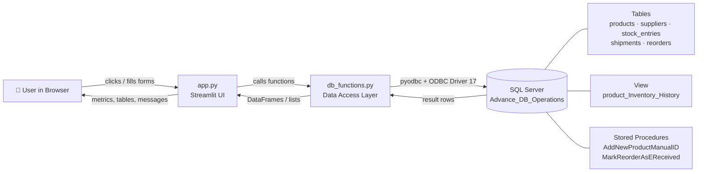
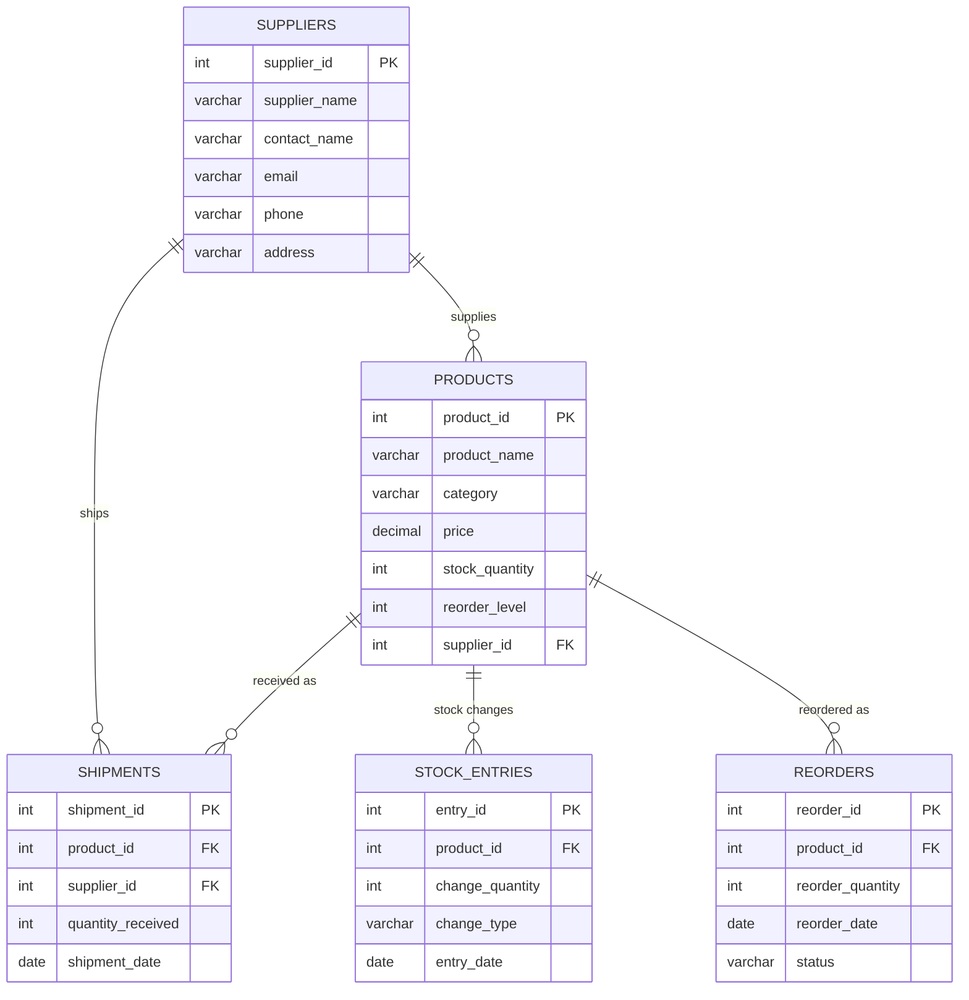
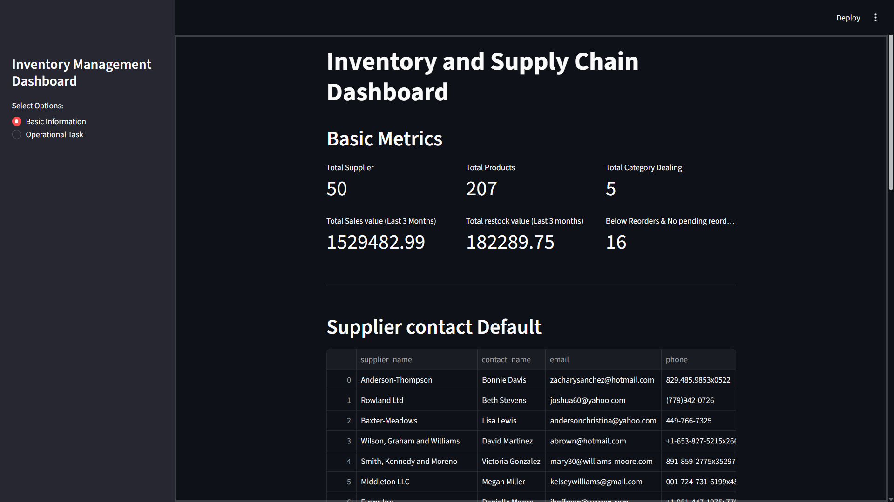
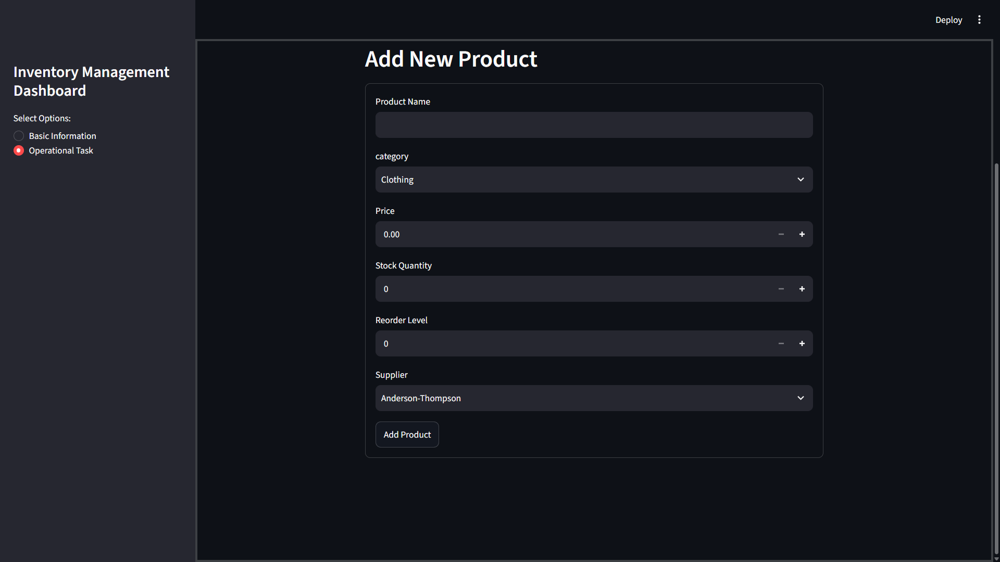
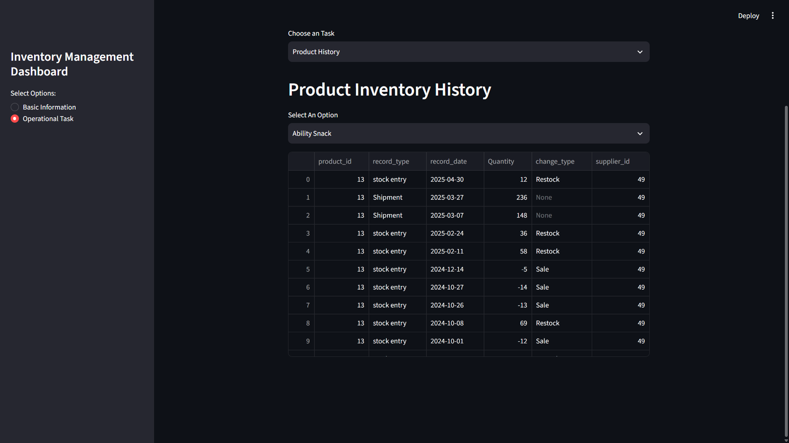
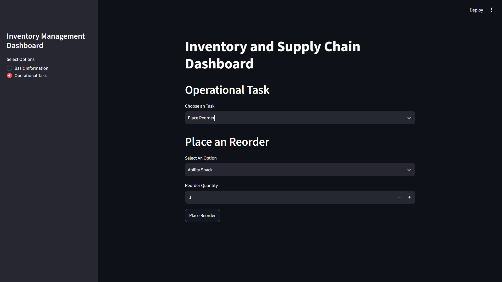
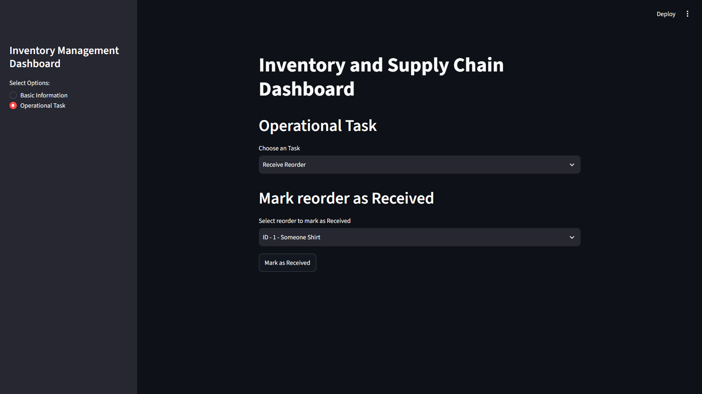

<div align="center">

# 📦 StockPulse — Inventory & Supply Chain Dashboard

### A Python + SQL Server + Streamlit app that turns raw inventory tables into a live, operational dashboard.


</div>

---

## 📖 Table of Contents

1. [Overview](#-overview)
2. [Key Features](#-key-features)
3. [Tech Stack](#-tech-stack)
4. [Project Structure](#-project-structure)
5. [How Everything Works Together](#-how-everything-works-together)
6. [Database Design](#-database-design)
7. [SQL Concepts Demonstrated](#-sql-concepts-demonstrated)
8. [File-by-File Explanation](#-file-by-file-explanation)
9. [Getting Started](#-getting-started)
10. [Using the Dashboard](#-using-the-dashboard)
11. [Known Issues & Roadmap](#-known-issues--roadmap)
12. [Skills Showcased](#-skills-showcased)
13. [Author](#-author)

---

## 🔎 Overview

Most inventory tracking lives in spreadsheets or raw SQL scripts that only a database person can run. **StockPulse** puts a clean web interface on top of a SQL Server database so that anyone can:

- see the health of the business at a glance (KPIs),
- spot products that are running low,
- and perform day-to-day operations (add products, place reorders, receive shipments) **without writing a single line of SQL**.

All the heavy lifting (aggregations, joins, transactions, stored procedures, views) is done **inside SQL Server**. Python acts as the bridge, and Streamlit provides the interface.

---

## ✨ Key Features

### 📊 Dashboard (Basic Information)
| Metric | Description |
|---|---|
| Total Suppliers | Number of suppliers in the system |
| Total Products | Number of products in the catalogue |
| Total Categories | Distinct product categories handled |
| Sales Value (last 3 months) | Revenue calculated from `Sale` stock entries |
| Restock Value (last 3 months) | Money value of restocked goods |
| Below Reorder Level & No Pending Reorder | Products that urgently need action |

Plus three live tables: **supplier contact list**, **products with their supplier and current stock**, and **products needing reorder**.

### 🛠️ Operational Tasks
| Task | What it does |
|---|---|
| ➕ **Add New Product** | Calls a stored procedure that inserts the product, logs the initial shipment, and records a stock entry, all in one go |
| 🕑 **Product History** | Shows the complete shipment and stock-movement timeline for any product (powered by a SQL View) |
| 🔁 **Place Reorder** | Creates a new reorder request with an auto-generated ID |
| 📥 **Receive Reorder** | Marks a reorder as received via a transactional stored procedure that updates stock, shipments and stock entries together |

---

## 🧰 Tech Stack

| Layer | Technology |
|---|---|
| Database | Microsoft SQL Server (SQL Server Express) |
| Query Language | T-SQL (views, stored procedures, transactions, CTE-style subqueries) |
| Backend / Glue | Python, `pyodbc` |
| Data Handling | `pandas` |
| Frontend | Streamlit |
| Prototyping | Jupyter Notebook |

---

## 🗂️ Project Structure

> Recommended layout for the repository:

```
StockPulse/
│
├── app.py                         # Streamlit UI (pages, forms, buttons)
├── db_functions.py                # Data-access layer (all DB connections & queries)
├── requirements.txt               # Python dependencies
├── README.md
│
├── sql/
│   └── SQL_Database_Operations.sql    # DB creation, analysis queries, view, stored procedures
│
├── notebooks/
│   └── UI_code.ipynb              # Prototype: connection testing & function development
│
├── docs/                          # Screenshots used in this README
│   ├── dashboard.png
│   ├── add-new-product.png
│   ├── product-history.png
│   ├── place-reorder.png
│   └── receive-reorder.png
│
└── data/
    ├── products.csv               # 200 products
    ├── suppliers.csv              # 50 suppliers
    ├── stock_entries.csv          # 3,000 stock movements (sales / restocks)
    ├── shipments.csv              # 1,000 supplier shipments
    └── reorders.csv               # 500 reorder requests
```

---

## 🔄 How Everything Works Together



**Flow in plain words**

1. The user selects a page in the Streamlit sidebar (`app.py`).
2. `app.py` never talks to the database directly. It calls a function from `db_functions.py`.
3. `db_functions.py` opens the connection through `pyodbc`, runs a query or executes a stored procedure, and returns the result.
4. The result is displayed as KPI cards (`st.metric`), tables (`st.dataframe`), or success/error messages.

This separation (UI ↔ data layer ↔ database) keeps the code clean and easy to extend.

---

## 🧱 Database Design

**Database name:** `Advance_DB_Operations`



| Table | Rows | Purpose |
|---|---|---|
| `suppliers` | 50 | Supplier master data and contact details |
| `products` | 200 | Product catalogue with price, current stock, reorder level |
| `stock_entries` | 3,000 | Every stock movement (negative = sale, positive = restock / new product) |
| `shipments` | 1,000 | Goods received from suppliers |
| `reorders` | 500 | Reorder requests and their status |

---

## 🧠 SQL Concepts Demonstrated

| Concept | Where it is used |
|---|---|
| Aggregations (`COUNT`, `SUM`, `ROUND`, `ABS`, `COALESCE`) | KPI metrics |
| `JOIN`s | Sales value, product ↔ supplier listing |
| Sub-queries | Dynamic "last 3 months" window using `DATEADD(MONTH, -3, MAX(entry_date))`, and `NOT IN` for pending reorders |
| `UNION ALL` | Merging shipments and stock entries into one history |
| **View** | `product_Inventory_History` |
| **Stored Procedures** | `AddNewProductManualID`, `MarkReorderAsEReceived` |
| **Transactions** | `BEGIN TRANSACTION … COMMIT` for consistent multi-table updates |
| Parameterised queries | `?` placeholders in `pyodbc` (protects against SQL injection) |

---

## 📄 File-by-File Explanation

### `SQL_Database_Operations.sql`
The SQL backbone of the project, organised in three parts:

1. **Exploration & KPIs** – creates the database, previews every table, and defines the dashboard metrics.
2. **Reports** – supplier contacts, product + supplier + stock, products needing reorder.
3. **Operational tasks** – the view and stored procedures that the UI calls.

| Object | Type | Purpose |
|---|---|---|
| `AddNewProductManualID` | Stored Procedure | Generates the next `product_id`, `shipment_id`, `entry_id`, then inserts into `products`, `shipments`, `stock_entries` |
| `product_Inventory_History` | View | Unified timeline of shipments and stock entries per product |
| `MarkReorderAsEReceived` | Stored Procedure | In a transaction: marks the reorder *Received*, adds stock to the product, logs a shipment and a *Restock* entry |

### `db_functions.py`: Data Access Layer
| Function | Responsibility |
|---|---|
| `sql_connector()` | Creates the `pyodbc` connection to SQL Server |
| `get_basic_info(cursor)` | Runs the six KPI queries, returns a dictionary |
| `get_additional_tabels(cursor)` | Runs the three report queries, returns a dictionary of DataFrames |
| `get_categories(cursor)` / `get_supplier(cursor)` | Populate dropdowns in the Add Product form |
| `Add_new_manual_id(...)` | Executes the `AddNewProductManualID` stored procedure |
| `get_all_products(cursor)` | Product list for dropdowns |
| `get_product_history(cursor, product_id)` | Reads from the history view |
| `place_reorder(...)` | Inserts a new reorder with `MAX(reorder_id)+1` |
| `get_pending_reorders(cursor)` | Lists reorders to be received |
| `mark_reorder_as_received(...)` | Executes `MarkReorderAsEReceived` |

### `app.py`: Streamlit Frontend
- **Sidebar** radio: *Basic Information* / *Operational Task*.
- **Basic Information** page: 2 rows × 3 `st.metric` cards + three tables.
- **Operational Task** page: a select box switches between the four tasks, each with input validation and `try/except` error messages.

### `UI_code.ipynb`: Prototype Notebook
Where the project began: testing the SQL Server connection, building and debugging each query and helper function before moving it into `db_functions.py`.

### `data/*.csv`
Sample datasets used to populate the database (see [Database Design](#-database-design)).

---

## 🚀 Getting Started

### Prerequisites
- Python 3.9+
- SQL Server (Express edition is fine) + SQL Server Management Studio (SSMS)
- [ODBC Driver 17 for SQL Server](https://learn.microsoft.com/sql/connect/odbc/download-odbc-driver-for-sql-server)

### 1. Clone the repository
```bash
git clone https://github.com/<your-username>/<repo-name>.git
cd <repo-name>
```

### 2. Install dependencies
```bash
pip install -r requirements.txt
```
`requirements.txt`
```
streamlit
pandas
pyodbc
```

### 3. Set up the database
1. Open **SSMS** and run the first two lines of `sql/SQL_Database_Operations.sql`:
   ```sql
   CREATE DATABASE Advance_DB_Operations;
   USE Advance_DB_Operations;
   ```
2. Import each CSV from `data/` into a table with the **same name** (right-click the database → *Tasks* → *Import Flat File…*), keeping the column names from the CSV headers.
3. Run the rest of the SQL script to create the view and stored procedures.

### 4. Configure the connection
In `db_functions.py`, edit the server name to match your machine:
```python
"SERVER=YOUR_PC_NAME\\SQLEXPRESS;"
```

### 5. Run the app
```bash
streamlit run app.py
```
Open **http://localhost:8501** in your browser.

---

## 🖥️ Using the Dashboard

| Step | Action |
|---|---|
| 1 | Choose **Basic Information** in the sidebar to see KPIs and tables |
| 2 | Choose **Operational Task** and pick a task from the dropdown |
| 3 | **Add New Product** → fill in the form → *Add Product* |
| 4 | **Product History** → select a product → view its full timeline |
| 5 | **Place Reorder** → choose product & quantity → *Place Reorder* |
| 6 | **Receive Reorder** → pick a pending reorder → *Mark as Received* |

### 📸 Screenshots

#### 1. Dashboard: Basic Metrics
KPI cards for suppliers, products, categories, 3-month sales and restock value, and products that are below reorder level with no pending order, followed by the supplier contact table.

<p align="center">
  
</p>

#### 2. Add New Product
A validated form that calls the `AddNewProductManualID` stored procedure. One click inserts the product, logs the initial shipment, and records the stock entry.

<p align="center">
  
</p>

#### 3. Product History
Pick any product to see its complete timeline of shipments and stock entries (sales and restocks), powered by the `product_Inventory_History` view.

<p align="center">
  
</p>

#### 4. Place Reorder
Select a product and a quantity to create a new reorder with an auto-generated ID.

<p align="center">
  
</p>

#### 5. Receive Reorder
Mark a reorder as received. The `MarkReorderAsEReceived` procedure updates the reorder status, product stock, shipments, and stock entries in a single transaction.

<p align="center">
  
</p>

---

## 🛣️ Known Issues & Roadmap

Being transparent about these makes the project stronger.

**Things to tighten up**
- [ ] `MarkReorderAsEReceived` selects `supplier_id` from `products` without a `WHERE` clause. Add `WHERE product_id = @product_id`.
- [ ] The procedure and the reorder INSERT use `CURRENT_DATE`, which isn't T-SQL. Use `CAST(GETDATE() AS DATE)`.
- [ ] `get_pending_reorders` doesn't filter on `status`. Add `WHERE ro.status = 'Pending'`.
- [ ] Reorder statuses in the sample CSV are `Ordered` / `Received`, while the app uses `Pending`. Align them.
- [ ] `MAX(id)+1` ID generation is not safe under concurrent users. Switch to `IDENTITY` columns.
- [ ] Open the DB connection once per session (`st.cache_resource`) and keep credentials out of the code (environment variables / `st.secrets`).

**Future enhancements**
- [ ] Charts: sales vs restock trend, category-wise stock (Plotly / Altair)
- [ ] Low-stock alerts and supplier performance analytics
- [ ] Export reports to CSV / Excel
- [ ] Deploy online with a cloud database
- [ ] Authentication and role-based access

---

## 🎯 Skills Showcased

`SQL (T-SQL)` · `Stored Procedures` · `Views` · `Transactions` · `Database Design` · `Python` · `pandas` · `pyodbc` · `Streamlit` · `Data Pipelines` · `KPI Design` · `Modular Code Architecture`

---

## 👤 Author

**Rohit**
- GitHub: [@your-username](https://github.com/your-username)
- LinkedIn: [your-linkedin](https://linkedin.com/in/your-linkedin)

⭐ If you found this project useful, consider giving it a star!
